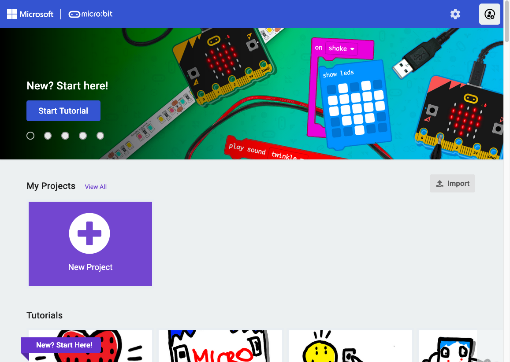
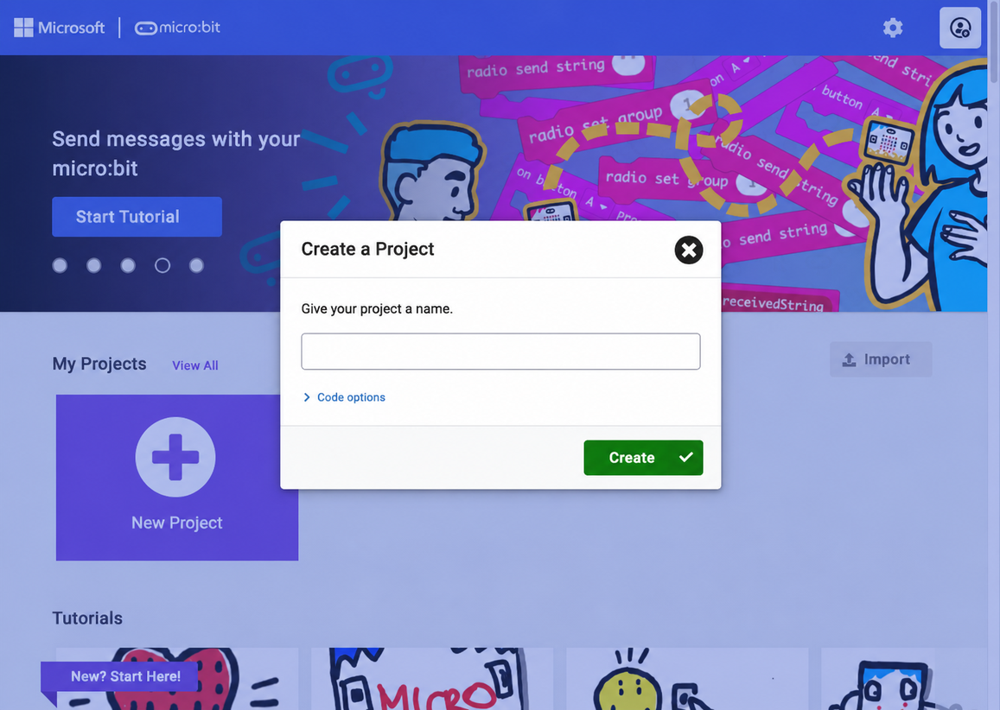
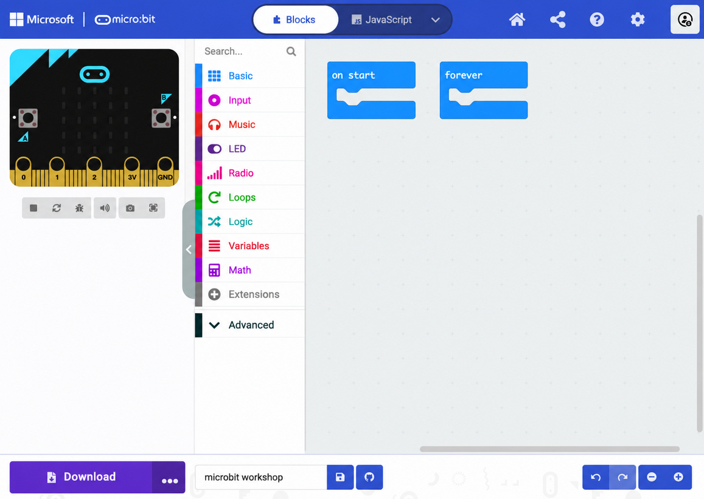
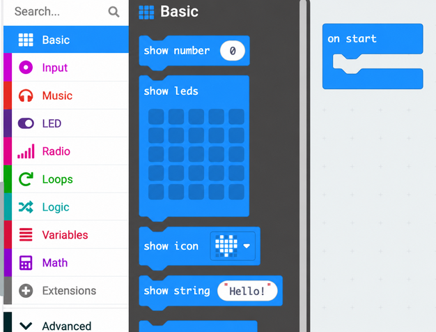
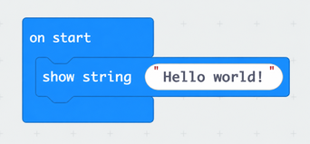

# 📱 Introduction to MakeCode

## What is MakeCode?

MakeCode is a super cool website where you can program your micro:bit without writing complicated code. It's like playing with building blocks, but to make programs!

## Step 1: Open MakeCode

1. Open your web browser (Chrome, Firefox, Safari, etc.)
2. Go to: **makecode.microbit.org**
3. You're in MakeCode!

## Step 2: Create your first project

1. Click the "New Project" button
2. Give your project a name, for example: "My first program"
3. Click "Create"

## Step 3: Get to know the editor

Now you're in the MakeCode editor! Let's look at the important parts:

### The simulator (left)
It's a virtual micro:bit! Here you can see how your program works before sending it to the real micro:bit.

### The toolbox (middle)
Here are all the blocks you can use. They're organized in categories with different colors:
- 🔵 **Basic**: Basic commands like showing text or pictures
- 🩷 **Input**: To use buttons, sensors, etc.
- 🔴 **Music**: To make sounds and music
- 🟣 **LED**: To control the lights
- And many more...

### The workspace (right)
This is where you drag and connect blocks to build your program.

## Your First "Hello World"

Let's make your first program!

### Step 1: Find the right block
1. In the toolbox, click the "Basic" category (blue)
2. Look for the block that says "show string"
3. Drag it to the workspace
4. Snap it inside the "on start" block that's already there

### Step 2: Write your message
1. Click the text that says "Hello!" inside the block
2. Delete it and type "Hello world!"
3. Look at the simulator! Your message is already scrolling across the virtual micro:bit's screen

### Step 3: Try your program
Congratulations! You've made your first program. In the simulator you can see the letters appear one by one on the micro:bit's screen.

## What have you learned?

- ✅ How to open MakeCode
- ✅ How to create a new project
- ✅ The main parts of the editor
- ✅ How to drag and connect blocks
- ✅ Your first program: Hello World!

## Ready for the next project?

Great! Now that you know the basics, let's do something more fun in [Project 2: Magic buttons](02-botones-caras.md).

---

> [!TIP]
> If you want to experiment, try changing the text to your name or another message. Programming is more fun when you experiment!
