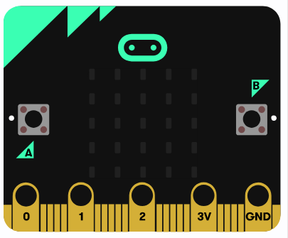
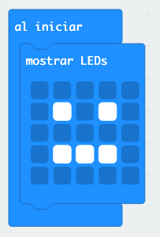
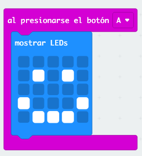
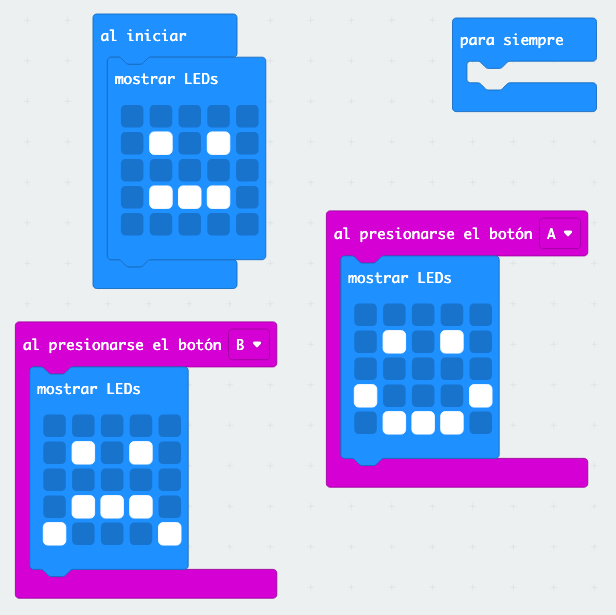
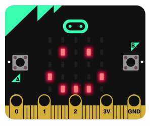
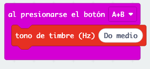

# 😊 Magic Buttons - Happy and Sad Faces

In this project you'll learn to use the micro:bit's buttons to show different faces! It's like giving your micro:bit feelings.

## What are we going to do?

We're going to program the micro:bit so that:
- When you press button A, it shows a happy face 😊
- When you press button B, it shows a sad face 😢
- At the start, it shows a neutral face

## The micro:bit's buttons

The micro:bit has two main buttons:
- **Button A**: On the left
- **Button B**: On the right

## Step 1: Create a new project

1. In MakeCode, click "Home" to go back to the main menu
2. Create a new project and call it "Button faces"

## Step 2: Show a neutral face at the start

First, let's make a neutral face appear when the micro:bit turns on.

1. Go to the "Basic" category (blue)
2. Drag the "show leds" block into the "on start" block
3. Click the little squares to draw a neutral face:

## Step 3: Program button A (happy face)

Now let's make a happy face appear when you press button A.

1. Go to the "Input" category (pink)
2. Drag the "on button A pressed" block to the workspace
3. Go to "Basic" and drag a "show leds" inside the button A block
4. Draw a happy face by clicking the LEDs:

## Step 4: Program button B (sad face)

Now button B for the sad face!

1. Back in "Input", drag another "on button A pressed"
2. Change button A to button B
3. Add a "show leds" inside
4. Draw a sad face:

## Step 5: Try your program!

1. Look at the micro:bit simulator
2. Click button A on the simulator - you should see the happy face!
3. Click button B on the simulator - you should see the sad face!
4. Click the restart button (the circle with an arrow) - the neutral face is back!

## Experiment more!

### Idea 1: Add more feelings
What happens if you press both buttons at the same time? You can add that too!

1. Go to "Input", find "on button A pressed", and change A to A+B
2. Add it and draw a surprised or angry face

### Idea 2: Add sounds
Give each face its own sound!

1. Go to the "Music" category (red)
2. Drag "play tone" blocks after each "show leds"
3. Choose different tones for each feeling

## What have you learned?

- ✅ How to use the micro:bit's A and B buttons
- ✅ How to draw with the LEDs using "show leds"
- ✅ How to make the micro:bit react to different actions
- ✅ That you can make interactive programs

## Common problems

> [!HINT] 🤔 A button doesn't work?
> - Make sure you chose the right button (for example, A instead of B).
> - Check that the "show leds" block is inside the button block.

> [!HINT] 🤔 The face doesn't look right?
> - Check that you clicked the right LEDs.

## Ready for more adventures?

Fantastic! In the next project we'll make the micro:bit notice when you move it. Go to [Project 3: On the move!](03-acelerometro.md)!

---

> [!TIP]
> You can make any faces you like! Try a face with glasses, one sticking its tongue out, or even drawings that aren't faces. Let your imagination run wild!
