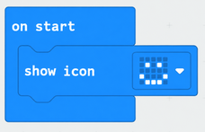
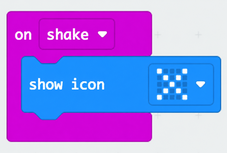
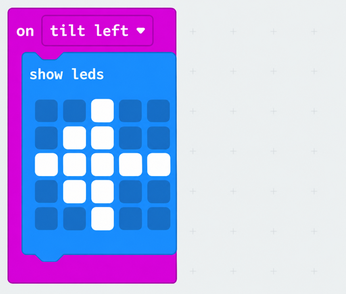
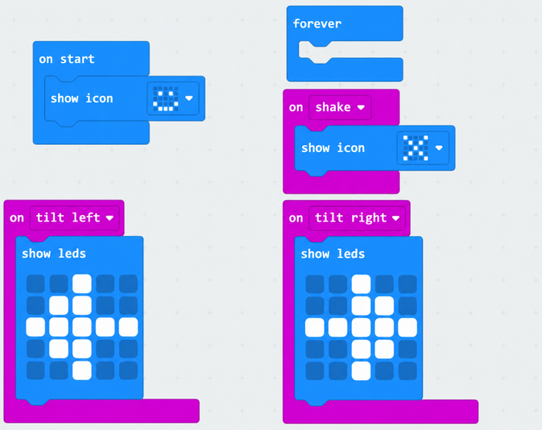
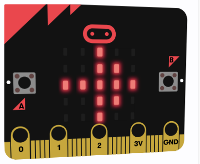
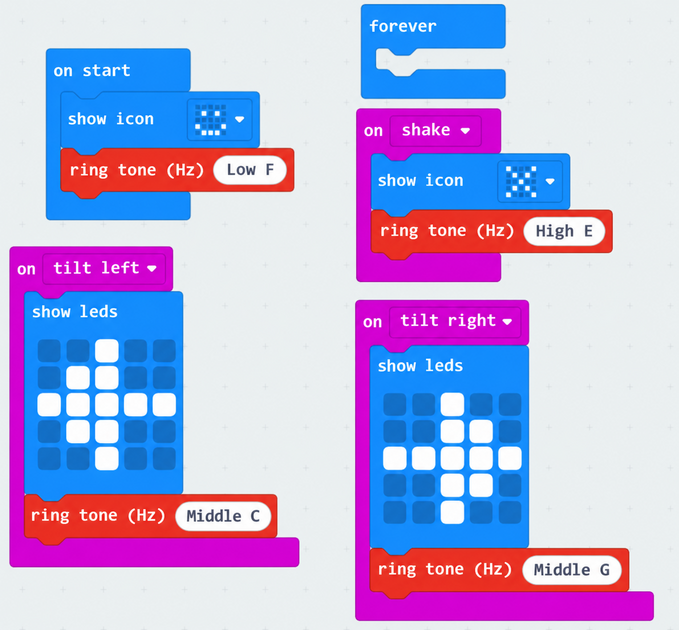
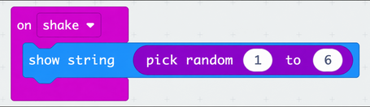

# 🏃 On the Move! - Using the Accelerometer

The micro:bit has a super cool sensor that can tell when you move it! It's called an accelerometer, and in this project you'll learn to use it.

## What is an accelerometer?

An accelerometer is like a magic sensor that can tell:
- If you shake the micro:bit
- If you tilt it left or right
- If you turn it upside down
- If you move it suddenly

It's the same sensor phones use to turn the screen around!

## What are we going to do?

We're going to make a program that:
1. **When you shake** the micro:bit: shows an X
2. **When you tilt it left**: shows an arrow pointing left
3. **When you tilt it right**: shows an arrow pointing right
4. **Normally**: shows a normal face

## Step 1: Create the project

1. Create a new project called "Movement detector"
2. First, let's show a normal face at the start
3. This time we'll use "show icon" instead of "show leds"

In the "on start" block, add a "show icon" with this face:

## Step 2: Notice when you shake the micro:bit

Let's do something fun when you shake the micro:bit!

1. Go to the "Input" category (pink)
2. Find the "on shake" block
3. Drag it to the workspace
4. Inside it, put a "show icon" with an X:

## Step 3: Notice tilting to the left

Now let's make an arrow appear when you tilt the micro:bit.

1. In "Input", find "on shake"
2. Drag it to the workspace
3. Change "shake" to "tilt left"
4. Add a "show leds" with an arrow pointing left:

## Step 4: Notice tilting to the right

The same for the right!

1. Add an "on tilt right"
2. Put in an arrow pointing right:

## Step 5: Try your program!

1. In the simulator, you can pretend to move it:
   - Click "SHAKE" to pretend to shake it
   - Move your mouse over the simulated micro:bit to tilt it

## Let's make it better!

### Add more movements

You can add more kinds of movement:
- "on screen up"
- "on screen down"
- "on free fall"

### Add sounds

Give each movement its own sound!

1. Go to "Music" and add "ring tone (Hz)" after each "show leds"
2. Use different tones for each movement:
   - Shake: high and fast tone
   - Left/right: middle tones
   - Normal: soft tone

## Fun experiment: Digital dice

Let's make dice that roll when you shake the micro:bit!

1. Change the "on shake" block
2. Instead of showing an X, use "show number"
3. Go to "Math" and find "pick random 1 to 6"
4. Now every time you shake it, a number from 1 to 6 appears!

## What have you learned?

- ✅ What an accelerometer is and what it's for
- ✅ How to detect different kinds of movement
- ✅ The blocks: "on shake", "on tilt"
- ✅ How to make a program that reacts to real movement
- ✅ How to make digital dice

## Common problems

> [!HINT] 🤔 Shaking doesn't work?
> - In the simulator, make sure you click "SHAKE"
> - If you're using a real micro:bit, shake it harder (but carefully!)

> [!HINT] 🤔 Tilting doesn't work well?
> - Tilt the micro:bit more clearly to one side
> - In the simulator, make sure the simulated micro:bit tilts to the right side.

## Extra challenges

1. **Step counter**: Make a number go up every time you shake it (like a pedometer)
2. **Movement alarm**: Make an alarm sound when it detects movement
3. **Balance game**: Show "Good!" only when it's completely flat

## Ready for your next project?

Amazing! You've mastered the micro:bit's sensors. Now let's put everything you know together to make a super smart flashlight. Go to [Project 4: Smart Flashlight](04-linterna-inteligente.md).

---

> [!TIP]
> The accelerometer is very sensitive. If your program reacts too much, try gentler movements. And if it doesn't react enough, move it more firmly!
