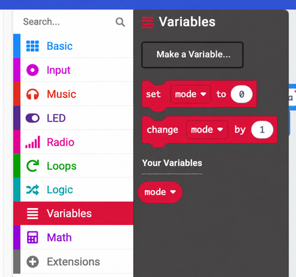
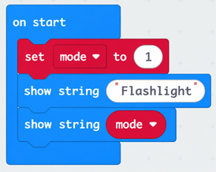
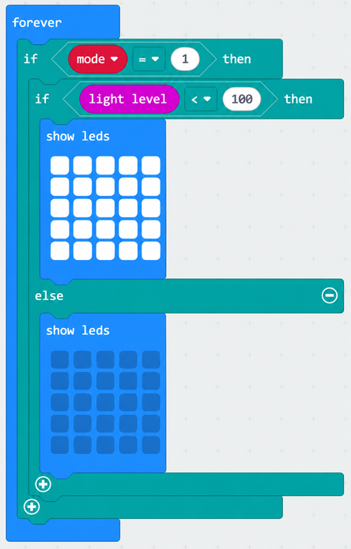
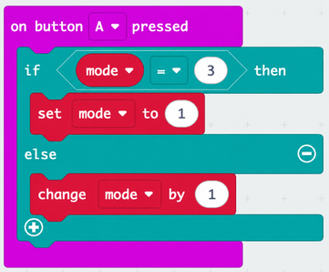
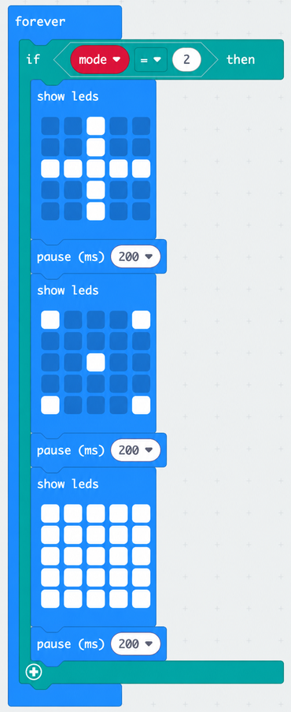
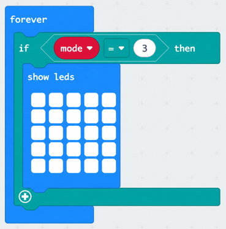

# 🔦 Smart Flashlight

Let's turn your micro:bit into a super smart flashlight that turns on by itself when it gets dark and has special modes!

## What are we going to do?

Our smart flashlight will have:
- 🌙 **Automatic mode**: Turns on when it gets dark
- 🕺 **Disco mode**: Lights that flash to the beat
- 🔦 **Normal flashlight mode**: Always on

## What is the light sensor?

The micro:bit can "see" whether it's light or dark using its **light sensor**. It's like an electronic eye! The sensor gives us a number:
- **0 = Very dark** (like at night)
- **255 = Very bright** (like in the sun)

## Step 1: Create the project

1. Create a new project called "Smart Flashlight"
2. We'll start with a variable to remember which mode we're using

### Create variables:
1. Go to "Variables"
2. Make a variable called "mode"



## Step 2: Getting started

In the "on start" block:

1. **Set mode to 1** (we start in automatic mode)
2. **Show string "Flashlight"**
3. **Pause for 1 second**
4. **Show number** with the variable "mode"



## Step 3: Program the automatic mode

Here comes the magic! Let's make the flashlight notice when it's dark.

For this we'll use the "forever" block

### Decide whether to turn on the flashlight:
1. Go to "Logic" and drag an "if... then... else" block
2. Put it inside the "forever" block
3. Go to "Input" and find the "light level" block
4. Program this logic:

```
if mode = 1 then
    if light level < 100 then
        show leds (all on)
    else
        clear screen
```

> [!TIP]
> The "light level" block is in the "Input" category and gives you the sensor's value directly.



## Step 4: Change mode with button A

Let's be able to switch between modes:

1. Drag "on button A pressed"
2. Inside that block, program the mode change:

```
if mode = 3 then
    set mode to 1
else
    change mode by 1
show number mode
```

The modes will be:
- **1** = Automatic
- **2** = Disco
- **3** = Normal flashlight



## Step 5: Disco mode

Now the most fun mode! Lights that change pattern quickly:

1. Go to "Basic" and add a new "forever" block
2. Inside that "forever" block, add this program

```
if mode = 2 then
    show leds (pattern 1)
    pause 200 ms
    show leds (pattern 2)
    pause 200 ms
    show leds (pattern 3)
    pause 200 ms
```



## Step 6: Normal flashlight mode

The easiest one, always on:

1. Go to "Basic" and add a new "forever" block
2. Inside that "forever" block, add this program

```
if mode = 3 then
    show leds (all on)
```



## Step 7: Try your flashlight!

1. **Try the automatic mode**: Cover the micro:bit with your hand to make it dark
2. **Press button A**: To switch between modes
3. **Disco mode**: It should look like a light party!

## Extra improvements

### Button B for disco mode
Add an "on button B pressed" that goes straight to disco mode:

```
set mode to 2
show icon music
```

### Adjust the light sensitivity
If the flashlight turns on too much or too little, change the number 100 to:
- **50** so it only turns on when it's very dark
- **150** so it turns on with just a little darkness

### Add sounds
Give each mode its own sound!

1. Go to the "Music" category
2. Add "play tone" blocks in each mode:
   - **Automatic mode**: A soft tone when it turns on (262 Hz)
   - **Disco mode**: A different tone with each pattern
     - Pattern 1: `play tone 262 Hz for 200 ms`
     - Pattern 2: `play tone 523 Hz for 200 ms`
     - Pattern 3: `play tone 1047 Hz for 200 ms`

### Rainbow mode
Add a fourth mode that cycles through different shape patterns!

## What have you learned?

- ✅ How to use the micro:bit's light sensor
- ✅ Programming with several modes
- ✅ Using "forever" loops for patterns
- ✅ Combining sensors with conditions
- ✅ Making light effects with timing

## Common problems

> [!HINT] 🤔 The flashlight doesn't turn on by itself?
> - Try covering the micro:bit completely with your hands
> - Change the value 100 to a higher number (like 150)

> [!HINT] 🤔 Disco mode is too fast or too slow?
> - Change the pause values: bigger numbers = slower
> - Try different speeds: 100ms, 300ms, 500ms

> [!HINT] 🤔 The mode doesn't change?
> - Check that the "mode" variable is updated correctly
> - Make sure the numbers in the conditions are right (1, 2, 3)

## Real uses

Your smart flashlight can be really useful!

- 🏕️ **Camping**: An automatic flashlight that turns on when it gets dark
- 🎉 **Parties**: Disco mode to liven things up
- 🔍 **Exploring**: A normal flashlight to look for things

## Ready for more fun?

Great! Now that you've mastered sensors and modes, let's make music with your micro:bit in [Project 5: Magic Piano](05-piano-magico.md).

---

> [!TIP]
> The micro:bit's light sensor is very useful. You can use it for lots of automatic projects like night lights, natural-light alarm clocks, or simple security systems.
