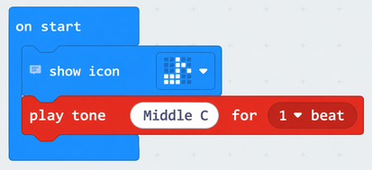
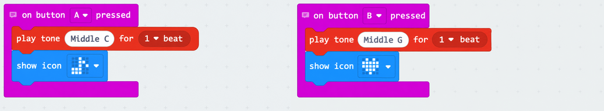
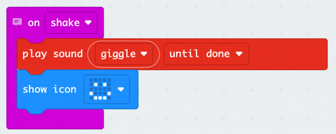
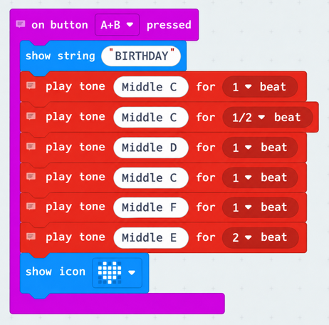

# 🎵 Magic Piano

Let's turn your micro:bit into a piano you can play with the buttons! You'll be able to make tunes, play songs you know and even write your own music.

## What are we going to do?

Our magic piano will have:
- 🎹 **Buttons as keys**: A and B play different notes
- 🎵 **A simple song**: "Happy Birthday"
- 🎶 **Fun effects**: Sounds when you shake the micro:bit

## How does sound work on the micro:bit?

The micro:bit can make music! Each note has a different sound:
- **C** = low sound
- **G** = high sound

It's like a piano: some keys sound low and others sound high!

## Step 1: Create the project

1. Create a new project called "Magic Piano"
2. This time we don't need variables! Let's go straight to the music.

## Step 2: Getting started

In the "on start" block:

1. **Show the music icon**
2. **Play tone Middle C for 1 beat** (a musical hello)

## Step 3: Program the basic keys

Let's make the buttons play notes!

1. Go to "Input" (pink) and drag "on button A pressed"
2. Go to "Music" (red) and drag "play tone Middle C for 1 beat"
3. Go to "Basic" and drag "show icon" with a music note

### For button B:
1. Same as button A, but change "C" to "G"
2. Use a different icon (like a heart)

## Step 4: Add fun effects

Let's make the micro:bit make sounds when you move it!

1. Go to "Input" and drag "on shake"
2. Add "play sound giggle" (or whichever sound you like best)
3. Add "show icon" with a happy face

## Step 5: Play a simple song

Let's program "Happy Birthday"!

1. Go to "Input" and drag "on button A+B pressed"
2. Add "show string" with "BIRTHDAY"
3. Now add these tones one after another:
   - Play tone C for 1 beat
   - Play tone C for 1/2 beat
   - Play tone D for 1 beat
   - Play tone C for 1 beat
   - Play tone F for 1 beat
   - Play tone E for 2 beats
4. Add "show icon" with a heart at the end

## Step 6: Try your piano!

1. **Press button A**: Does it play C?
2. **Press button B**: Does it play G?
3. **Shake the micro:bit**: Does it make a funny sound?
4. **Press A+B**: Does it play "Happy Birthday"?

## What have you learned?

- ✅ How to make music with the micro:bit
- ✅ Using buttons to play notes
- ✅ Programming a whole song
- ✅ Adding fun sound effects

## Extra improvements

### Add more sounds
Experiment with different sounds!

1. Go to "Music" and find "play sound"
2. Try sounds like "twinkle", "spring", "mysterious"
3. Add them to different buttons

### More notes
Want more notes?

1. Use the tilt gestures to play "E" and "F"
2. Add "on tilt left" with the tone E
3. Add "on tilt right" with the tone F

## Common problems

> [!HINT] 🤔 You can't hear anything?
> - Turn up the simulator's volume
> - Check that the blocks are inside the events

> [!HINT] 🤔 The song sounds strange?
> - Make sure the notes are in the right order
> - Check that each note has its length

## Ready for the grand finale?

Incredible! You've made your own musical instrument. Now let's do the final and biggest project: your very own game! Go to [Project 6: Rock, Paper, Scissors](06-piedra-papel-tijera.md).

---

> [!TIP]
> The best tunes mix high and low notes. Experiment with different combinations and find your own style!
