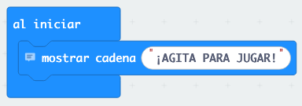
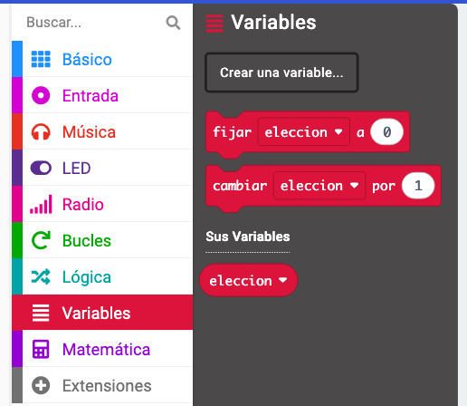
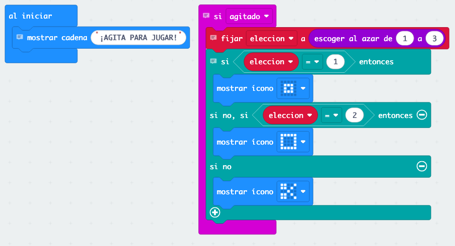
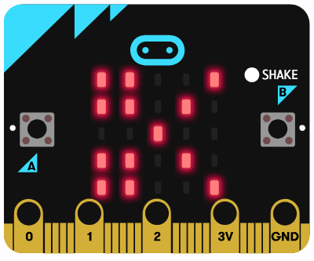

# 🎲 Let's Play! - Rock, Paper, Scissors

Let's make the most famous game in the world on your micro:bit! You'll be able to play with your friends anywhere.

## How does the game work?

The micro:bit will randomly choose between:
- 🗿 **Rock**: beats scissors, loses to paper
- 📄 **Paper**: beats rock, loses to scissors
- ✂️ **Scissors**: beats paper, loses to rock

## How to play?

1. You and your friend shake your micro:bits at the same time
2. A result appears on each micro:bit
3. Compare them to see who wins!

## Step 1: Create the project

1. Create a new project called "Rock Paper Scissors"
2. At the start, let's show a welcome message

In "on start", add:
- A "show string" block with "SHAKE TO PLAY!"



## Step 2: Program the game

Now comes the fun part! Let's make a random choice appear when you shake it.

1. Drag an "on shake" block to the workspace
2. We'll need a **variable** to remember the choice

### Make a variable:
1. Go to the "Variables" category
2. Click "Make a Variable..."
3. Call it "choice"



### Program the logic:
Inside the "on shake" block:

1. **Give it a random number**:
   - Drag "set choice to"
   - Go to "Math" and find "pick random 1 to 3"

2. **Decide what to show**:
   - Go to "Logic" and drag an "if... then... else" block
   - Click the plus sign ⊕ to add more conditions (you need 3 in total)

It will look like this:
```
if choice = 1 then
    show leds (rock)
else if choice = 2 then
    show leds (paper)
else
    show leds (scissors)
```



## Step 3: Try your game!

1. In the simulator, click "SHAKE"
2. Does one of the three options appear?
3. Try several times to see it change



## Fun improvements

### Add sound
Give each option its own sound:

1. Go to "Music"
2. Add different tones after each "show leds":
   - Rock: low tone (262 Hz)
   - Paper: middle tone (523 Hz)
   - Scissors: high tone (1047 Hz)

### Add a countdown
Make the game more exciting with a countdown!

Change the "on shake" block so it first does:
1. Show "3"
2. Pause for 1 second
3. Show "2"
4. Pause for 1 second
5. Show "1"
6. Pause for 1 second
7. Show the result!

## Advanced version: Multiplayer

Want to make the game even cooler? Let's add a scoreboard!

### Add buttons to compare
- **Button A**: "I won!"
- **Button B**: "I lost!"

### Make score variables
1. Make a variable called "my_points"
2. Make another one called "rival_points"

### Program the buttons
In "on button A pressed":
- Change "my_points" by 1
- Show "my_points"

In "on button B pressed":
- Change "rival_points" by 1
- Show "rival_points"

## What have you learned?

- ✅ How to use random numbers
- ✅ What variables are and how to use them
- ✅ How to use conditions (if... then...)
- ✅ How to make a whole game
- ✅ How to add sounds and effects

## Common problems

> [!HINT] 🤔 It always shows the same thing?
> - Check that you're using "pick random 1 to 3"
> - Make sure the variable changes every time you shake it

> [!HINT] 🤔 Nothing appears when you shake it?
> - Check that the "set choice" block is inside "on shake"
> - Check that the conditions are "choice = 1", "choice = 2", etc.

> [!HINT] 🤔 The drawings don't look right?
> - Check that you clicked the right LEDs in each "show leds"

## Extra challenges

1. **Add "Lizard" and "Spock"** (like in "The Big Bang Theory")
2. **Make a tournament**: The first to reach 5 points wins
3. **Hard mode**: Make the result appear faster
4. **Statistics**: Count how many times each option comes up

## Congratulations!

You've finished all the projects in the workshop! Now you have a micro:bit that can:
- Show messages
- React to buttons
- Notice movement
- And even play with you!

### What can you do now?

- Show your programs to your friends and family
- Experiment by mixing ideas from all the projects
- Find out what other sensors the micro:bit has
- Invent your own games and programs!

### Next steps

If you enjoyed programming, you can:
- Learn other programming languages
- Explore Arduino or Raspberry Pi
- Join a robotics club
- Keep making amazing things!

---

> [!TIP]
> Programming is like learning a new language. The more you practice, the better you get! Don't be afraid to experiment and try new things.
