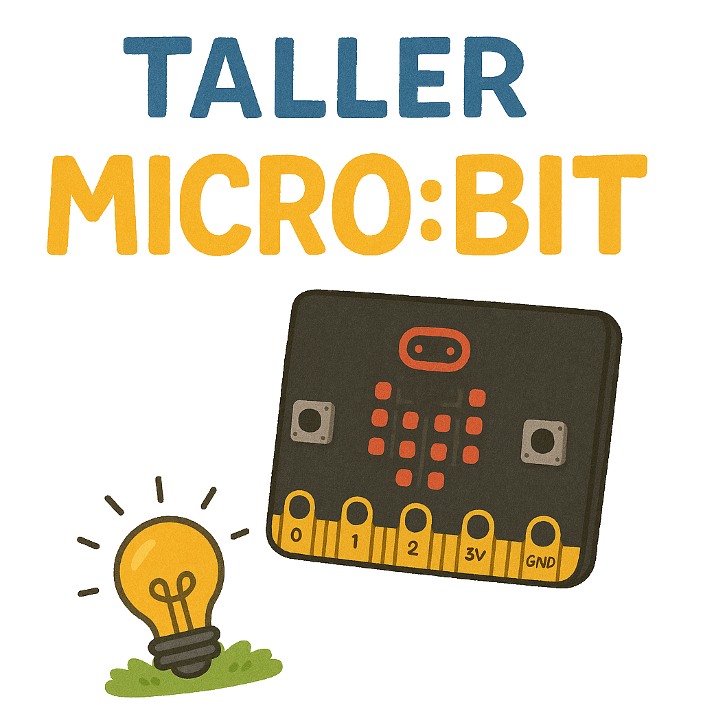

Welcome to the fantastic world of programming with the micro:bit!

## What is a micro:bit?

The micro:bit is a tiny computer that fits in your hand, and you can program it to do amazing things. It has LED lights, buttons, sensors and much more. It's like having a mini robot that does whatever you tell it to!

## What will you learn?

In this workshop you will learn to:
- 💻 Use MakeCode to program without writing complicated code
- 💡 Turn the micro:bit's lights on and off
- 🎮 Use the buttons to control your program
- 🎯 Detect movement with the accelerometer
- 🎲 Make your own rock, paper, scissors game

## What do you need?

- A computer or tablet with internet
- Lots of curiosity and ready to have fun
- A micro:bit (if you have one, great! If not, no problem, you can use the simulator)

> [!NOTE]
> The pictures in this workshop show MakeCode in Spanish. The blocks are the same in English: they have the same shape and color, and they are in the same place.

<!-- modules -->

## Ready?

Let's start with the [first project](01-introduccion-makecode.md)!

> [!IMPORTANT]
> If you get stuck on a project, don't worry. Raise your hand and ask for help. We're here to help you become an amazing programmer!
