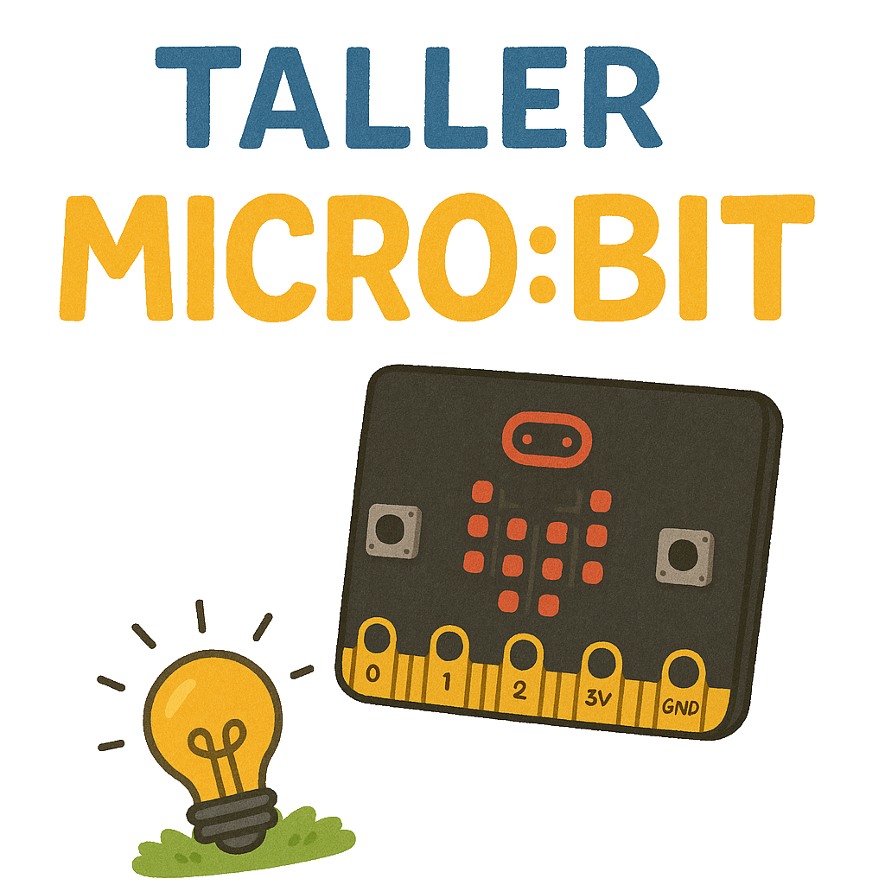

¡Bienvenidos al fantástico mundo de la programación con micro:bit!

## ¿Qué es micro:bit?

El micro:bit es un pequeño ordenador que cabe en tu mano y que puedes programar para hacer cosas increíbles. Tiene luces LED, botones, sensores y mucho más. ¡Es como tener un robot diminuto que hace lo que tú le digas!

## ¿Qué vas a aprender?

En este taller vas a aprender a:
- 💻 Usar MakeCode para programar sin escribir código complicado
- 💡 Hacer que las luces del micro:bit se enciendan y apaguen
- 🎮 Usar los botones para controlar tu programa
- 🎯 Detectar movimiento con el acelerómetro
- 🎲 Crear tu propio juego de piedra, papel o tijera

## ¿Qué necesitas?

- Un ordenador o tablet con internet
- Muchas ganas de aprender y divertirte
- Un micro:bit (si tienes uno, ¡genial! Si no, no pasa nada, puedes usar el simulador)

<!-- modules -->

## ¿Preparado?

¡Empecemos por el [primer proyecto](01-introduccion-makecode.md)!

> [!IMPORTANT]
> Si te quedas atascado en algún proyecto, no te preocupes. Levanta la mano y pide ayuda. ¡Estamos aquí para ayudarte a convertirte en un programador increíble!
